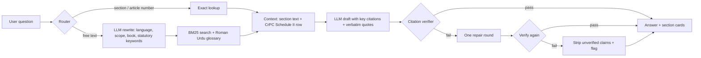

# Dafa — دفعہ

**Pakistan's law, section by section.** Ask about the Constitution of Pakistan or the Pakistan Penal Code in English, Urdu or Roman Urdu. Every answer cites the exact section, and every citation is checked against the official text before you see it.

> "Dafa 302 lag gayi." Millions of Pakistanis hear a section number at a police station or in a court notice and have no easy way to read what it says, whether it is bailable, or which court will hear it. Dafa answers that from the official text, in the language the person asked in.

Dafa gives legal information, not legal advice.

---

## What it does

- **Ask in your language.** English, Urdu script and Roman Urdu ("mobile chheen liya, kaunsi dafa lagti hai?"). The answer comes back in the same language; the law's own words stay in English.
- **Direct lookups.** Type `302`, `dafa 489-F` or `Article 25A` and the section opens instantly, with no LLM call.
- **Bail and arrest status.** Each Penal Code section is joined with its row in **CrPC Schedule II**: cognizable or not, bailable or not, compoundable or not, punishment, and trial court. These are shown as rubber stamps on the section card.
- **Verified citations.** A deterministic checker confirms that every `[ppc:379]` citation was actually retrieved, every quote is verbatim, and every "N years" appears in the source. Anything that fails is sent back for one repair round, then removed and flagged.
- **Browse the books.** A chapter-by-chapter navigator and a shareable page for every section.
- **Degrades gracefully.** If the LLM is down or rate-limited, Dafa still returns the right sections in search-only mode.

## Architecture



**Ingestion (offline, run once):** official PDFs → PyMuPDF with font sizes → drop footnotes, superscript amendment markers and running headers → split into sections/articles → join PPC sections with the CrPC Schedule II table → `backend/data/processed/*.json` (committed, so the server never parses PDFs).

**Why BM25 instead of embeddings for v1:** statutes use a fixed legal vocabulary and users often type exact numbers and terms. Lexical search handles that precisely, runs in milliseconds on Render's free tier with no extra services, and the LLM rewrite step maps everyday language onto the statute's words. The eval harness measures whether this is good enough. Hybrid search is on the roadmap if the numbers say otherwise.

| Layer | Tech |
|---|---|
| Backend | Python 3.12, FastAPI, uv |
| PDF extraction | PyMuPDF (font-aware) |
| Retrieval | Hand-written BM25 + Roman Urdu/Urdu glossary |
| LLM | Groq (`openai/gpt-oss-120b`, low reasoning effort, configurable) |
| Verification | Deterministic citation / quote / number checker |
| Frontend | Next.js 15 (App Router), TypeScript, plain CSS |
| Hosting | Render (API), Vercel (web) |

## Repository layout

```
Dafa/
├── backend/
│   ├── dafa/
│   │   ├── ingest/        PDF -> clean lines -> sections, CrPC Schedule II parser, build CLI
│   │   ├── retrieval/     router, tokenizer + glossary, BM25, LawStore
│   │   ├── llm/           Groq client (throttle, retry, usage), prompts
│   │   ├── pipeline/      answer orchestration, citation verifier
│   │   └── api/           FastAPI app
│   ├── data/raw/          official PDFs (input)
│   ├── data/processed/    extracted JSON (committed)
│   ├── evals/             golden set, harness, reports
│   └── tests/             pytest suite
├── frontend/              Next.js app (landing, /ask workspace, /read/[book]/[id])
├── render.yaml            Render blueprint for the API
├── PROGRESS.md            build log / checklist
└── CLAUDE.md              workflow rules for AI-assisted development
```

## Run it locally (Windows / macOS / Linux)

You need [uv](https://docs.astral.sh/uv/), Node.js 20+, and a free [Groq API key](https://console.groq.com/keys).

### 1. Backend

```bash
cd backend
uv sync                                  # creates .venv and installs everything
copy .env.example .env                   # macOS/Linux: cp .env.example .env
# open backend/.env and paste your GROQ_API_KEY
uv run uvicorn dafa.api.main:app --reload --port 8000
```

Check it: open http://localhost:8000/health and http://localhost:8000/docs.

### 2. Frontend

```bash
cd frontend
npm install
copy .env.example .env.local             # macOS/Linux: cp .env.example .env.local
npm run dev
```

Open http://localhost:3000.

### 3. Rebuild the law data (only if you change the PDFs or parsers)

The official PDFs are committed in `backend/data/raw/` (`constitution.pdf`, `ppc.pdf`, `crpc.pdf`; sources in PROGRESS.md). After changing a parser:

```bash
cd backend
uv run python -m dafa.ingest.build
```

This writes `backend/data/processed/constitution.json` and `ppc.json` and prints a summary (sections found, gaps in numbering, Schedule II rows joined).

## Tests and evals

```bash
cd backend
uv run pytest -q                                  # unit + integration tests
uv run python -m evals.run_evals                  # retrieval evals, offline and free
uv run python -m evals.run_evals --mode full      # end-to-end with Groq
```

The harness reports pass rate, hit@5, recall@5, MRR and verified-answer rate, broken down by question type (section lookup, situation to section, Roman Urdu, Urdu, Constitution rights, Schedule II facts, out-of-scope). Each run writes `evals/results/report.html` and appends to `evals/results/history.jsonl` so regressions show up between runs.

### Latest results

| Mode | Split | Cases | Pass rate | hit@5 | MRR |
|---|---|---|---|---|---|
| retrieval only | dev (used while tuning) | 44 | 98% | 0.974 | 0.810 |
| retrieval only | held-out (never tuned on) | 12 | 58% | 0.583 | 0.371 |
| full (Groq rewrite + verified answer) | both | 56 | pending | | |

The gap between dev and held-out is the honest finding: keyword search alone misses paraphrases like "lied under oath" (the law says "false evidence"). Full mode measures whether the LLM rewrite closes it. Details and the bug log are in [PROGRESS.md](PROGRESS.md).

### What the extraction produces

- **Constitution:** 328 articles (1 to 280, lettered articles included; 15 omitted ones flagged), amended up to the 27th Amendment
- **Penal Code:** 639 sections (1 to 511; 21 omitted ones flagged), amended up to 14 Dec 2023
- **CrPC Schedule II:** joined to 410 PPC sections (one scanned page in the source has no text layer)

No numbering gaps in either book; integrity checks live in `tests/test_processed_data.py`.

## Deploy

### Backend on Render

1. Push this repo to GitHub.
2. On [render.com](https://render.com): **New > Blueprint**, pick the repo. Render reads `render.yaml`.
3. Set the `GROQ_API_KEY` environment variable when asked.
4. After the frontend is live, set `ALLOWED_ORIGINS` to your Vercel URL (any `*.vercel.app` URL is already allowed).
5. Check `https://<your-service>.onrender.com/health`.

The free plan sleeps after inactivity; the first request after a nap takes up to a minute, and the frontend says so while it waits.

### Frontend on Vercel

1. On [vercel.com](https://vercel.com): **Add New > Project**, import the repo.
2. Set **Root Directory** to `frontend`.
3. Add the environment variable `NEXT_PUBLIC_API_URL` = your Render URL (no trailing slash).
4. Deploy.

## API

| Method | Path | What it returns |
|---|---|---|
| GET | `/health` | status, section counts, whether the LLM is configured |
| GET | `/books` | books with section counts |
| GET | `/books/{book}/toc` | parts/chapters with their sections |
| GET | `/sections/{book}/{id}` | one section with Schedule II info and prev/next |
| GET | `/search?q=&book=` | matching sections, no LLM |
| POST | `/ask` `{"query": "..."}` | answer, language, verified flag, warnings, quotes, sections, timings |

`book` is `constitution` or `ppc`.

## Production touches

- Per-IP rate limiting on `/ask` to protect the Groq quota
- LRU cache for verified answers
- One structured JSON log line per request (mode, language, verified, latency per stage, tokens, prompt version)
- Client-side throttling and retry with backoff for Groq 429s
- Prompt versioning, recorded in logs and eval reports

## Limitations

- Covers the Constitution and the Penal Code only. Special laws (PECA, CNSA, family laws) are not included yet.
- The text is as current as the PDFs in `data/raw/`. Amendments after that date are not reflected.
- Schedule II facts come from the CrPC table; provincial amendments may differ.
- Not legal advice. Dafa explains what the law says; it does not tell anyone what to do in their case.

## Roadmap

- CrPC and PECA 2016 as additional books
- Hybrid retrieval (BM25 + embeddings) if evals show recall gaps on situation questions
- Voice input in Urdu

---

Built by Muhammad Zain ul Abideen.
